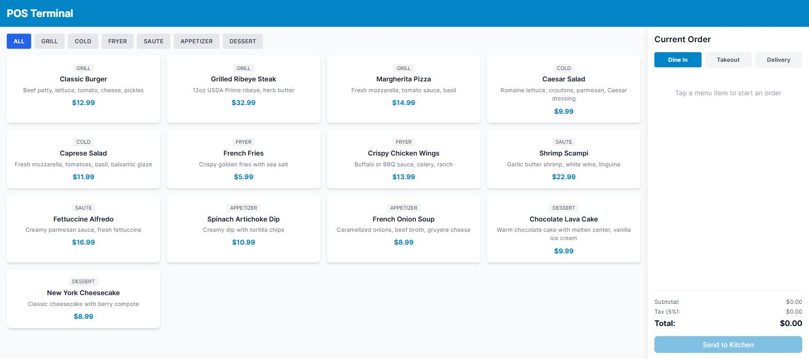
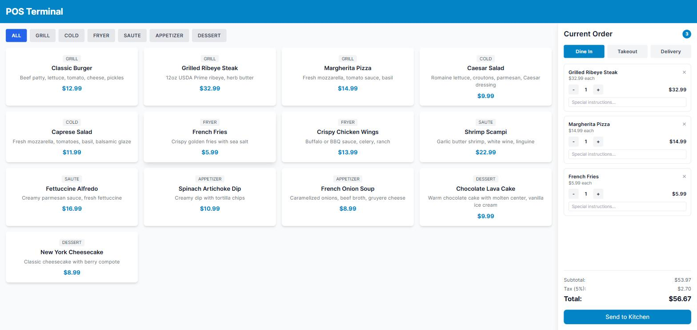
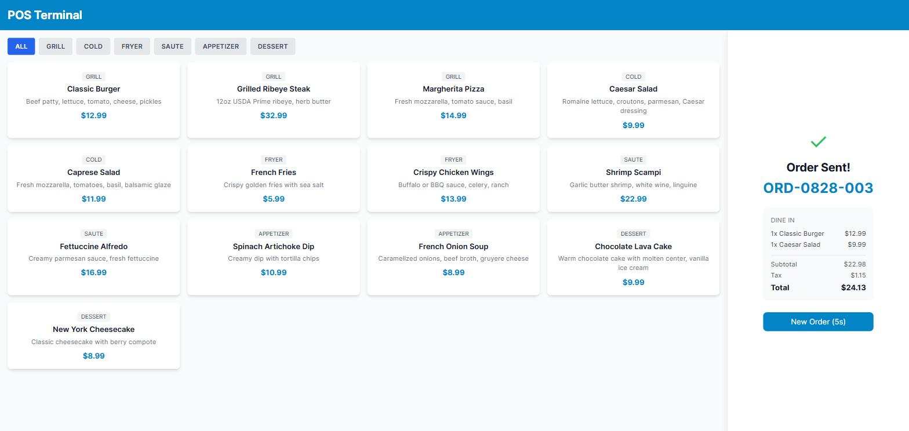
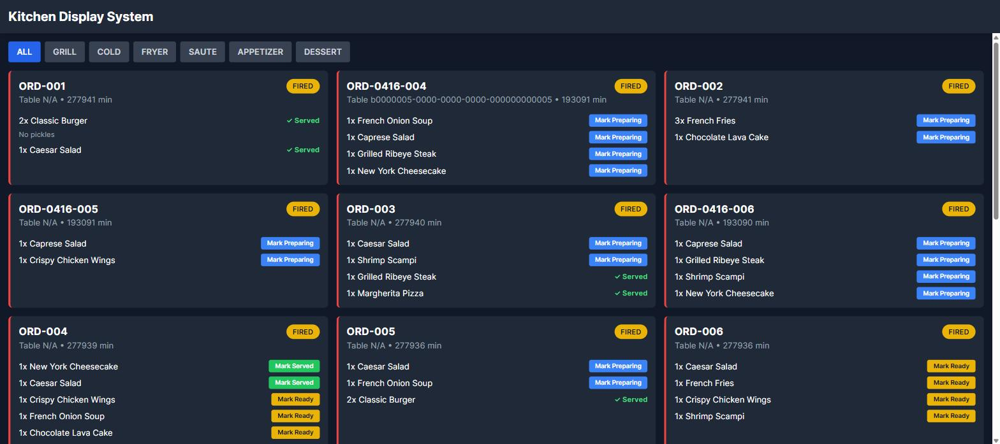
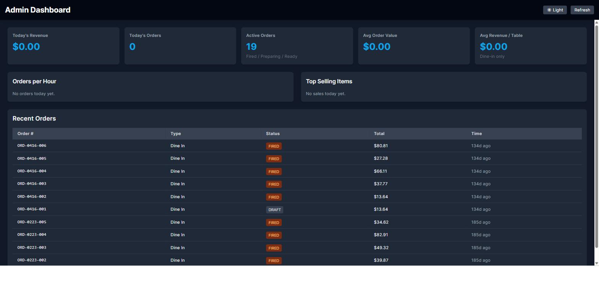

# Restaurant POS System

A full-featured restaurant Point of Sale system built with Spring Boot and React, featuring a Kafka-driven kitchen display: fired orders go through a transactional outbox and Kafka to the kitchen screen over WebSocket.

## 📸 Screenshots

| | |
| --- | --- |
|  |  |
| POS order terminal for building a dine-in, takeout, or delivery order | Cart with items added and subtotal / tax / total calculated live |
|  |  |
| Confirmation after an order is fired; the kitchen screen receives it through the outbox and Kafka | Kitchen Display System, order tickets updated live over WebSockets |
|  | |
| Admin dashboard with daily revenue, order volume, and recent order history | |

## 🚀 Features

- **Order Management**: Create, fire, and cancel orders; kitchen status moves FIRED → PREPARING → READY; an order completes only through payment
- **Kitchen Display System (KDS)**: Real-time order updates via WebSocket; the screen signs in as a kitchen user (seeded `kitchen1`, PIN 7890) and the socket is authenticated on the STOMP CONNECT frame
- **Kafka drives the kitchen display**: fire, item-status, and cancel events are written to an outbox table in the same database transaction as the change, a relay publishes them to Kafka, and the KDS consumer pushes the current order to the screen. If Kafka is down, orders wait in the outbox and reach the kitchen when it returns
- **Measured latency**: fire to card on screen, median 22.5 ms and worst 35 ms over 20 orders on the local stack ([docs/perf/kds-latency.md](docs/perf/kds-latency.md))
- **Payments**: Cash payments over the REST API with split-safe balance checks and idempotency keys (no payment screen in the POS UI yet); card via a mock terminal is planned ([docs/payment-implementation-plan.md](docs/payment-implementation-plan.md))
- **Table Management**: Table status (available, occupied, reserved, cleaning) and the assigned server

## 🏗️ Architecture

```
Frontend (React) ──REST──→ Spring Boot Backend ──same transaction──→ PostgreSQL (orders + outbox_events)
       ↑                                                                    │
       │                                                              outbox relay
       │                                                                    ↓
       └──WebSocket (STOMP)── KDS consumer ←──────────────────────── Apache Kafka
```

The only Kafka consumer is the kitchen display. No analytics or inventory consumers exist.

## 📋 Prerequisites

- Java JDK 21
- Node.js 22
- Docker Desktop
- Git

## 🚀 Quick Start

### 1. Start everything with Docker

```bash
cd docker
docker compose up -d
```

This starts PostgreSQL, Kafka (with ZooKeeper, Kafka UI and pgAdmin), the backend on http://localhost:8090 and the frontend on http://localhost:5173. Log in with a seeded PIN: admin 1234, manager1 5678, server1 9012, server2 3456, kitchen1 7890.

To run the backend and frontend from source instead (steps 2-3), start only the infrastructure:

```bash
docker compose up -d postgres zookeeper kafka kafka-ui pgadmin
```

### 2. Start Backend

```bash
cd backend
./mvnw spring-boot:run
```

Backend will be available at: http://localhost:8090

### 3. Start Frontend

```bash
cd frontend
npm install
npm run dev
```

Frontend will be available at: http://localhost:5173

## 📚 Documentation

- [SETUP.md](./SETUP.md): service URLs, credentials and troubleshooting
- [docs/perf/kds-latency.md](docs/perf/kds-latency.md): how the fire-to-screen latency was measured
- [docs/payment-implementation-plan.md](docs/payment-implementation-plan.md): payment design (cash built, card planned)
- [Restaurant_POS_Implementation_Guide.md](./Restaurant_POS_Implementation_Guide.md): the original design plan (December 2025); not all of it was built

## 🛠️ Tech Stack

### Backend
- Java 21
- Spring Boot 3.4.x
- Spring Data JPA
- Spring Kafka
- PostgreSQL
- Flyway (Database Migrations)

### Frontend
- React 18 + Vite
- Tailwind CSS 4
- WebSocket (Real-time Updates)

### Infrastructure
- PostgreSQL 16
- Apache Kafka 3.5 (Confluent `cp-kafka` 7.5.0)
- Docker & Docker Compose

## 📖 Project Structure

```
restaurant-pos/
├── docker/                 # Docker configuration
├── backend/               # Spring Boot application
├── frontend/              # React application
├── scripts/               # fire-orders.sh (latency measurement)
├── docs/                  # Payment plan, latency results, screenshots
└── Restaurant_POS_Implementation_Guide.md
```

## 🧪 Testing

### Backend Tests
```bash
cd backend
./mvnw test
```

`./mvnw test` runs only fast unit tests (`*Test`) and needs no Docker.

### Backend Integration Tests
Integration tests (`*IT`) boot the app against a throwaway Postgres (Testcontainers) and an embedded Kafka. They need Docker running (the `docker compose` stack does not need to be up).
```bash
cd backend
./mvnw verify -Pit
```

### Frontend Tests
```bash
cd frontend
npm test
```

### CI
Every pull request and every push to `master` runs `.github/workflows/ci.yml`: `./mvnw -B verify -Pit` (unit tests, then the integration tests), and in `frontend/` `npx vitest run`, `npm run lint` and `npm run build`.

## 📝 Development Workflow

1. **Phase 1**: Basic order creation and display
2. **Phase 2**: Kitchen Display System integration
3. **Phase 3**: Payment processing
4. **Planned**: LAN-first operation (see Roadmap)
5. **Phase 5**: Advanced features (reporting, analytics)

## 🔧 Configuration

- Backend: `backend/src/main/resources/application.yml` (the Docker stack overrides it with the `environment` entries in `docker/docker-compose.yml`)
- Kafka producer and consumer settings live in `config/KafkaConfig.java`; only `spring.kafka.bootstrap-servers` is read from `application.yml`

## 🗺️ Roadmap (planned, not built)

- LAN-first: devices talk over the restaurant Wi-Fi; if the connection drops, writes are stored locally and uploaded after reconnect.

## 📄 License

This is a learning project for educational purposes.

## 👤 Author

Changbeom(Stephen) Noh.

Created as a portfolio project to demonstrate production-grade software engineering practices.
